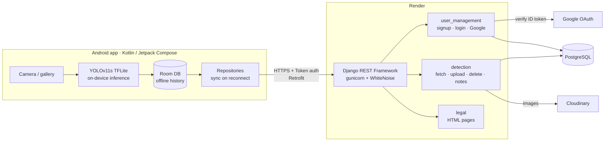
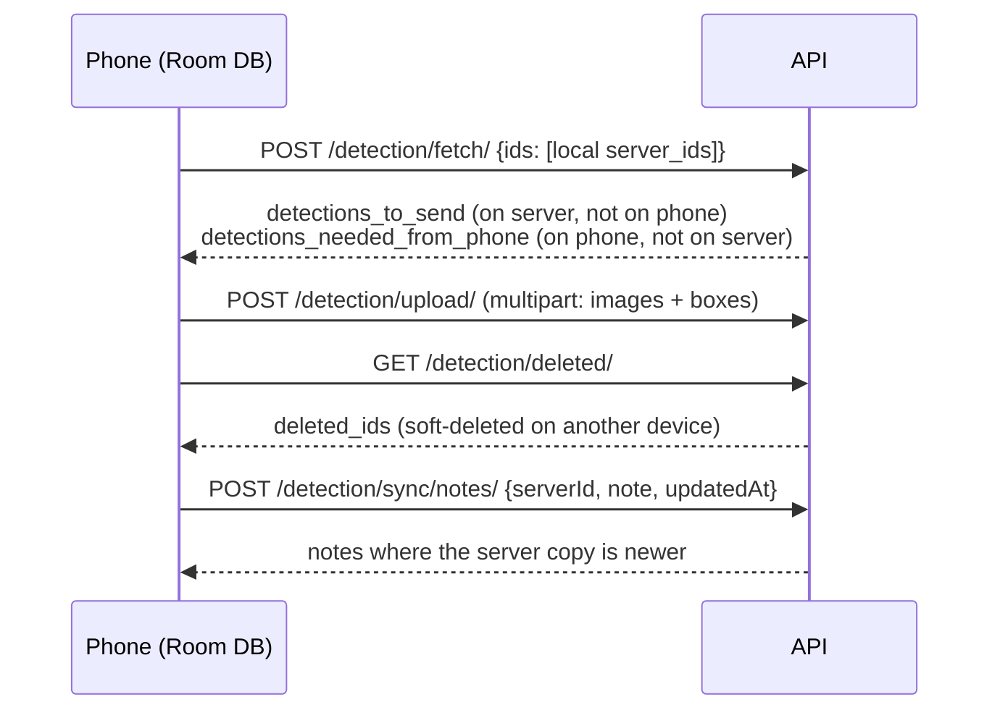
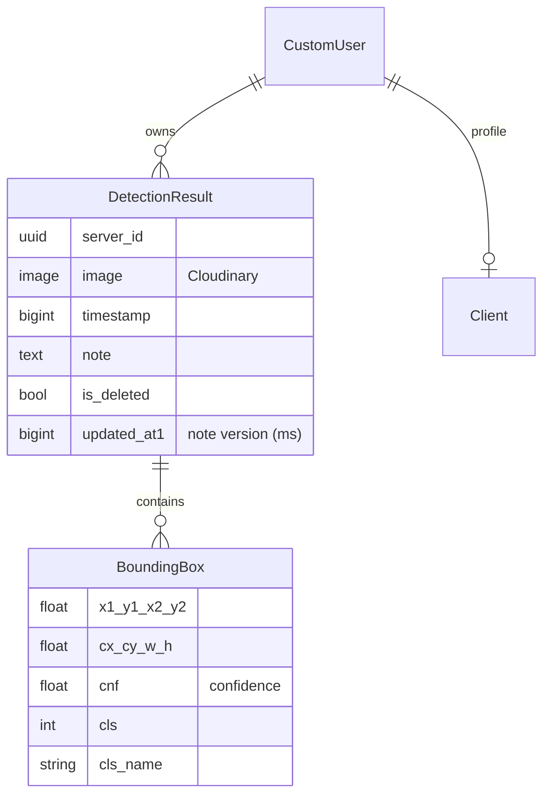

# Pest Detection App · Backend API

[](https://github.com/MehdiBedja/pest-detection-api/actions/workflows/tests.yml)


REST backend for **ScanPest AI**, an Android app that detects agricultural pests **offline** with an on-device YOLOv11s model (93.8% mAP@50). The phone runs inference. This API stores users, syncs each user's detection history (images, bounding boxes, notes) across devices, and serves the app's legal pages.

> Part of the [Mobile Agricultural Pest Detection System](https://github.com/MehdiBedja/pest-detection-system):
> [AI research](https://github.com/MehdiBedja/pest-detection-computer-vision) · [Android app](https://github.com/MehdiBedja/pest-detection-android) · **Backend**

## What it does

- **Accounts**: username/password signup and login, plus Google Sign-In (ID-token verification). Token authentication, password change and set-password for Google users.
- **Offline-first sync**: the phone sends the detection IDs it has, and the server answers with what the phone is missing and what it needs from the phone. Detections are uploaded in batches (multipart: images + JSON bounding boxes).
- **Soft delete**: deletions are flags, so they propagate to the user's other devices.
- **Note sync**: per-detection notes use last-write-wins on a millisecond `updatedAt` timestamp.
- **Image storage** on Cloudinary, data in PostgreSQL, hosted on Render.
- **Legal pages** (privacy policy, terms, account deletion) required for the Play Store.

## Architecture



### Sync flow



### Data model



## API

All endpoints except signup, login, Google auth and legal pages require `Authorization: Token <key>`.

| Method | Endpoint | Description |
| --- | --- | --- |
| POST | `/user_management/signup` | Create account `{user_type: "client", user: {...}}` |
| POST | `/user_management/login` | Returns `{token, user}` |
| POST | `/user_management/test` | Sign up with a Google ID token |
| POST | `/user_management/google_sign_in` | Sign in with a Google ID token |
| GET | `/user_management/get_user_info/` | Current user profile |
| GET | `/user_management/check_is_google_user` | Whether the account uses Google auth |
| POST | `/user_management/change_password` | Change password |
| POST | `/user_management/set_password` | Set a password on a Google account |
| POST | `/user_management/logout` | Revoke the token |
| POST | `/detection/fetch/` | Sync diff between phone and server |
| POST | `/detection/upload/` | Batch upload detections (multipart) |
| POST | `/detection/<uuid>/delete/` | Soft-delete one detection |
| POST | `/detection/delete/batch/` | Soft-delete several `{server_ids: [...]}` |
| GET | `/detection/deleted/` | IDs soft-deleted on the server |
| POST | `/detection/sync/notes/` | Last-write-wins note sync |
| GET | `/privacy-policy/`, `/terms/`, `/app-info/`, `/account-deletion/` | Public legal pages |

## Run it locally

```bash
git clone https://github.com/MehdiBedja/pest-detection-api.git
cd pest-detection-api
python -m venv venv && source venv/bin/activate   # Windows: venv\Scripts\activate
pip install -r requirements.txt
cd pest_detection_backend
```

Create `pest_detection_backend/.env`:

```env
SECRET_KEY=change-me
DEBUG=True
ALLOWED_HOSTS=localhost,127.0.0.1,10.0.2.2
SECURE_SSL_REDIRECT=False

DB_ENGINE=django.db.backends.postgresql
DB_NAME=pest_detection
DB_USER=postgres
DB_PASSWORD=postgres
DB_HOST=localhost
DB_PORT=5432

CLOUDINARY_CLOUD_NAME=...
CLOUDINARY_API_KEY=...
CLOUDINARY_API_SECRET=...

GOOGLE_CLIENT_ID=...
GOOGLE_CLIENT_SECRET=...
```

Then run the migrations and start the server:

```bash
python manage.py migrate
python manage.py runserver 0.0.0.0:8000
```

`10.0.2.2` lets the Android emulator reach your machine's `localhost`.

## Tests

The suite has 23 API tests covering auth, sync, soft delete, note conflict resolution and legal pages. It uses in-memory SQLite and local storage, so it needs **no database, Cloudinary account or `.env`**:

```bash
cd pest_detection_backend
python manage.py test --settings=pest_detection_backend.settings_test
```

GitHub Actions runs it on every push.

## Project structure

```
pest_detection_backend/
├── pest_detection_backend/   # settings, settings_test, urls, wsgi
├── user_management/          # CustomUser, token + Google auth
├── detection/                # DetectionResult, BoundingBox, sync endpoints
├── legal/                    # privacy policy / terms templates
└── manage.py
```

## Deployment

Deployed on **Render** with gunicorn (`gunicorn pest_detection_backend.wsgi`). WhiteNoise serves static files, Cloudinary stores media, and PostgreSQL is managed by Render. Production uses HTTPS redirect, HSTS and secure cookies.

## Screenshots

| Android app | Detection result | Sync history |
| --- | --- | --- |
|  |  |  |

<!-- Screenshot placeholders: add images to docs/screenshots/ -->

## Author

**Mahdi Bedja**, AI Engineer · [Portfolio](https://mehdibedja.github.io) · [LinkedIn](https://www.linkedin.com/in/mahdi-bedja-0b94031b3/)
